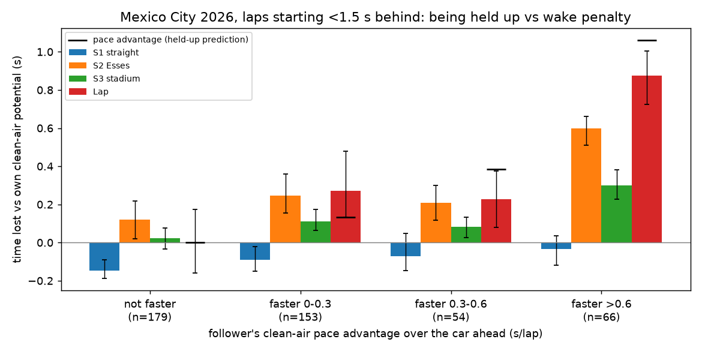

# Held up vs. wake penalty vs. tyre damage — 2026 Mexico City GP

Follow-up to [data_audit.md](data_audit.md). The first-look model showed +0.26 to +0.69 s/lap when following
within 1 s, but follower lap times tracked the leader's at r = 0.97. This analysis separates three things:
**being held up** by a slower car, the follower's own **wake penalty**, and **accumulating tyre damage**.

Run:
```bash
PYTHONPATH=src uv run python -m tire_tracks.heldup
PYTHONPATH=src uv run python -m tire_tracks.persistence
```

## 1. Clean-air pace potential

Mixed model on free-air laps (gap ahead > 3 s, 340 laps), fitted separately for the lap and each sector:
`time ~ qualifying best + compound + tyre_age × compound + lap_number + (1 | driver)`.
Pit stops reset tyre age, so across stints tyre wear and race progress are separable. Qualifying anchors
drivers with few free-air laps (HAM has 3).

| | Estimate |
|---|---|
| Tyre wear, MEDIUM | +0.042 s/lap (±0.004) |
| Tyre wear, SOFT | +0.037 s/lap (±0.003) |
| Race progress (fuel burn + track evolution) | −0.023 s/lap (±0.001) |
| Qualifying → race pace | 0.81 s per 1 s of quali gap |
| Cross-validated RMSE (grouped by stint) | lap 0.44 s (raw sd 1.07), S1 0.17, S2 0.26, S3 0.16 |

Mixed model vs. qualifying alone: lap RMSE 0.44 vs. 0.52.

## 2. Held up vs. wake penalty (main result)

Laps that **start** < 1.5 s behind the car ahead, grouped by the follower's clean-air pace advantage
(leader potential minus follower potential). Time lost vs. the follower's own potential, with 95% CI
from a bootstrap clustered by driver.



| Follower vs. leader | n | Lap | S1 straight | S2 Esses | S3 stadium |
|---|---|---|---|---|---|
| **Not faster** (mean −0.49) | 179 | **+0.00** [−0.16, +0.17] | **−0.15** [−0.19, −0.09] | **+0.12** [+0.02, +0.22] | +0.02 [−0.03, +0.08] |
| Faster 0–0.3 (mean 0.13) | 153 | +0.27 [+0.13, +0.48] | −0.09 | +0.25 | +0.11 |
| Faster 0.3–0.6 (mean 0.38) | 54 | +0.23 [+0.08, +0.37] | −0.07 | +0.21 | +0.08 |
| Faster > 0.6 (mean 1.06) | 66 | **+0.87** [+0.72, +1.00] | −0.03 | **+0.60** | **+0.30** |

**Reading:**
- **Wake penalty, from cars that cannot be held up:** about **+0.12 s in the Esses**, cancelled by about
  **−0.15 s of slipstream on the straight**. Net lap penalty is about **zero**.
- **Being held up:** faster followers lose roughly their whole pace advantage (+0.87 s for a 1.06 s
  advantage), and the loss sits in S2/S3 where Mexico can't be passed. This is most of the
  "dirty-air penalty" in the first-look model.
- The 0–0.3 s group loses more than its advantage (+0.27 vs. 0.13), which fits the ~0.1 s Esses
  wake penalty on top of being held up.

### Within-lap gap pattern (no potential model needed for the outcome)
Gap change across each sector to the same car on the same lap, regressed on the sector potential
difference and the start gap (reference 1.5–3 s):

| Start gap | S1 | S2 | S3 | Lap |
|---|---|---|---|---|
| < 0.5 s | **−0.18** [−0.27, −0.09] | +0.03 | +0.05 | −0.09 |
| 0.5–1.0 s | **−0.11** [−0.19, −0.04] | +0.08 [−0.01, +0.16] | +0.02 | −0.02 |
| 1.0–1.5 s | +0.02 | 0.00 | +0.02 | +0.04 |

Cars within 1 s close up on the straight and lose some of it in the Esses. The slope on potential
difference is 0.57–0.78, well below 1, so followers can't convert their full pace advantage.

### Pitfall avoided
Over a lap that starts and ends close, follower lap = leader lap + gap change, *by definition*. Comparing
the follower to the leader at lap level only reproduces the pace advantage, so it isn't evidence of
anything. Only the start-of-lap gap is used for conditioning above.

## 3. Tyre damage: accumulation and persistence

**Accumulation inside the wake** (57 runs of ≥ 3 consecutive laps behind the same car, 336 laps,
18 drivers, longest 22 laps). Per extra consecutive lap, controlling for potential difference and start gap:

| Sector | Gap change to leader, per lap in wake | Excess vs. own potential, per lap in wake |
|---|---|---|
| S1 | **−0.009** [−0.015, −0.003], p = 0.005 | −0.003 (n.s.) |
| S2 | **+0.012** [+0.005, +0.020], p = 0.002 | −0.000 (n.s.) |
| S3 | +0.000 (n.s.) | +0.001 (n.s.) |
| Lap | +0.005 (n.s.) | −0.003 (n.s.) |

The corner-loss-then-catch-up pattern **widens the longer a car follows**: about +0.12 s more Esses loss
and −0.09 s more straight gain after 10 laps. Both effects survive a Bonferroni correction for the 8 tests.
But the follower's time vs. **its own** potential does **not** grow. Two explanations fit:
1. Gradual loss of front grip in the wake, offset by a stronger tow.
2. The follower deliberately backing off in the Esses to line up a run on the 1.2 km straight.

**These can't be separated without tyre temperatures or steering data.** Neither is public.

**Persistence after exit:** only **9 clean exits** in the race (6 passes, 3 leader stops). Exits where
the gap "just opened" are excluded because they're selected on the follower's own slow lap. **That is too
few to estimate.** The proposal's thermal-memory kernel (λ, α) needs post-exposure laps and **can't be
identified from one race.**

## 4. Case: Hamilton chasing Verstappen
22 laps starting < 1.5 s behind VER (laps 2–6, 48–58, 64–71). The model puts VER 0.24 s/lap faster.
HAM ran 0.49 s/lap *better* than his own potential, with S1 −0.23 and S2 −0.19. Treat this with
caution: HAM has only 3 free-air laps, so his potential rests on qualifying plus shrinkage, and is probably
underestimated. This doesn't show a dirty-air penalty for HAM.

## Conclusions (one race, so preliminary)
1. Most of the apparent dirty-air penalty is **being held up**, not lost aero performance.
2. The true wake effect is a **trade between sectors**: about +0.1 s in the Esses, about −0.15 s on the
   straight, about 0 net.
3. The trade **grows with time in the wake**. Whether that's tyres or driver tactics isn't identifiable
   from public data.
4. **Persistence and the altitude question need multiple races.** Next step: run the same pipeline on
   every 2026 race, plus Mexico 2023–2025 under the old rules.

## Known limitations
- Selection: being close at the start of a lap is not random (serial correlation in pace).
- Lap-level potential RMSE (0.44 s) is larger than the effects, so the conclusions rest on averages over 50–180 laps.
- Same-lap shocks shared by follower and leader (wind, traffic further ahead) are not modelled.
- 2026 energy deployment (battery recovery after an attack) is unobserved. It could shift time between
  sectors, mostly in S1.
