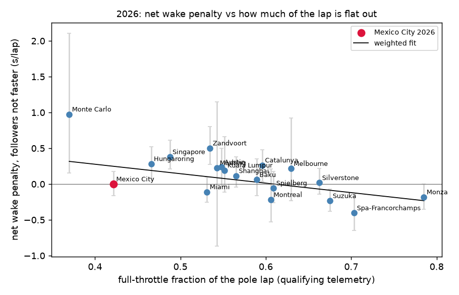

# Multi-race results: 19 races of 2026 + Mexico City 2023–25

Same pipeline as the single-race study ([heldup_and_persistence.md](heldup_and_persistence.md)), run on
every 2026 race so far plus Mexico City 2023–2025 (previous rules). Outputs are in `reports/multirace/`.

```bash
PYTHONPATH=src uv run python -m tire_tracks.catalog     # session list + download (throttled for OpenF1)
PYTHONPATH=src uv run python -m tire_tracks.multirace   # build, model, pool
PYTHONPATH=src uv run python -m tire_tracks.trackchar   # pole-lap full-throttle fraction per track
```

## Data

| | |
|---|---|
| Races | 22 (19 in 2026; Bahrain and Jeddah cancelled; "Bahrain GP" run at Kuala Lumpur) |
| Laps | 25,948 total → 19,173 clean → 18,828 used in models (driver has quali data, ≥ 10 clean laps, compound has ≥ 15 free-air laps) |
| Close-following laps (start gap < 1.5 s, matched to leader) | 5,928 |
| Wake exits not caused by the follower's own slow lap | 190 (127 passes, 63 leader stops); 165 with a timed exit lap |

Extra cleaning for multi-race use:
- Race-control messages are clipped to the race window (session tables include other days).
- Both "VSC" and "VIRTUAL SAFETY CAR" wordings are parsed, as are VSC→SC upgrades and red-flag restarts
  behind the SC.
- Wet-tyre and rain laps are excluded.
- A **pace backstop** excludes laps where the field median is > 7% above the green-flag reference. It caught
  slow laps just before VSC/SC calls and wet-track laps at Kuala Lumpur and Zandvoort.
- Per-race exclusion counts: `reports/multirace/race_summary.csv`.

## 1. Being held up vs. the wake penalty (pooled, CI clustered by race)

| Follower vs. leader (clean-air potential) | n | 2026 (19 races) | Mexico 2023–25 (3 races) |
|---|---|---|---|
| Not faster | 2,741 | +0.07 [−0.07, +0.24] | +0.11 [−0.05, +0.40] |
| Faster 0–0.3 (mean 0.14) | 1,135 | +0.31 [+0.23, +0.38] | +0.36 [+0.14, +0.44] |
| Faster 0.3–0.6 (mean 0.44) | 722 | +0.38 [+0.27, +0.51] | +0.49 [+0.11, +0.63] |
| Faster > 0.6 (mean ~1.2) | 1,330 | **+1.02** [+0.69, +1.37] | +0.48 [+0.39, +0.54] |

**The single-race finding replicates across 19 tracks.** Faster followers lose most of their pace
advantage (being held up). Followers that can't be held up show no significant net lap penalty on average.

**Except at very close range** (2026, followers not faster, by start gap):

| Start gap | n | Net lap penalty |
|---|---|---|
| < 0.5 s | 334 | **+0.46** [+0.26, +0.76] |
| < 0.5 s, same car ahead the whole lap (no position change) | 226 | **+0.38** [+0.21, +0.63] |
| 0.5–1.0 s | 1,120 | +0.04 [−0.13, +0.27] |
| 1.0–1.5 s | 855 | −0.06 [−0.16, +0.05] |

Inside half a second there's a real net loss even without a position change, although it still includes
off-line defending and attack attempts. Beyond 0.5 s the slipstream gain cancels the cornering loss.

## 2. Track layout explains the size of the wake effect



Each track's full-throttle fraction is measured from the pole lap's throttle trace in qualifying
(`track_characteristics.csv`): Monza 0.79, Spa 0.70, Monaco 0.37.

- Net wake penalty vs. full-throttle fraction, 2026, inverse-variance weighted: **−1.32 s per unit**
  [−2.26, −0.38], p = 0.009, R² = 0.34.
- Power tracks (Spa −0.40, Suzuka −0.23, Monza −0.18) give a **net gain** from following: the tow wins.
- Twisty tracks (Monaco +0.98, Zandvoort +0.50, Singapore +0.38, Hungaroring +0.28) give a **net loss**.
- Mean speed gives the same picture (p = 0.013).

## 3. Mexico City: altitude and the 2026 rules

**Against other 2026 tracks.** Fitting the line without Mexico and allowing for between-track spread
(τ = 0.13 s), Mexico 2026 is **0.39 s/lap below** the prediction for its flat-out fraction
[−0.75, −0.03], z = −2.1. That's the *opposite* of the proposal's hypothesis: dirty air costs **less** at
altitude, not more. One explanation fits the physics: thinner air means less downforce to lose and less
drag to tow off. Caveats:
- It's one high-altitude venue, so altitude and Mexico's layout can't be separated.
- Mexico's 2026 full-throttle fraction (0.42) is below its 2023–25 value (0.49), probably from 2026 energy
  management. With 0.49 the residual shrinks to about −0.26.
- z = −2.1 is marginal evidence.

**Mexico across rule sets** (same track, so sectors are comparable). Followers not faster than the car
ahead, 2026 minus 2023–25, bootstrap over driver-races:

| | 2023–25 | 2026 | Difference [95% CI] |
|---|---|---|---|
| S1 straight (tow) | −0.20 | −0.15 | +0.05 [−0.02, +0.13] |
| **S2 Esses** | +0.25 | +0.12 | **−0.13 [−0.25, −0.01]** |
| S3 stadium | +0.07 | +0.02 | −0.05 [−0.11, +0.02] |
| Lap | +0.11 | 0.00 | −0.11 [−0.32, +0.11] |

The cornering loss in the Esses roughly **halved** under the 2026 rules. The net lap difference isn't significant.

## 4. Tyre damage: accumulation and persistence

**Accumulation** (656 runs of ≥ 3 laps behind the same car), per extra consecutive lap, controlling for pace
difference, gap and race:

| | Own excess vs. potential | Gap to leader |
|---|---|---|
| 2026 | −0.016 s/lap [−0.037, +0.004], n.s. | +0.004 s/lap [+0.001, +0.007], p = 0.013 |
| Mexico 2023–25 | **+0.015 s/lap** [+0.004, +0.027], p = 0.011 | +0.006 (n.s.) |

Under the old rules, a follower's own pace dropped about 0.15 s after 10 laps in the wake. In 2026 there's
no own-pace build-up, only a slow drift back from the leader.

**Persistence after exit** (190 exits; excess vs. potential). The run's last close lap is followed by
the **exit lap** (k = 0). That lap still *starts* in the wake: the follower is a median 0.59 s behind the
old car and gets free during it, by passing or because the leader turns into the pits. Post-exit laps
(k ≥ 1) must start **and** end more than 2 s from the car ahead.

| Lap | n | Excess | Main speed trap vs. own free-air median |
|---|---|---|---|
| 0, exit lap: all | 165 | +0.22 [+0.07, +0.40] | **+12.3 km/h** (in the tow) |
| 0, exit lap: leader pitted | 48 | **+0.55** [+0.37, +0.76] | |
| 0, exit lap: follower passed | 117 | +0.08 [−0.06, +0.28] | |
| 1 | 83 | −0.01 [−0.12, +0.09] | +0.3 km/h |
| 2 | 81 | +0.03 [−0.06, +0.11] | −1.0 km/h |
| 3–5 | 224 | −0.11 to +0.03, n.s. | −0.7 to 0.0 km/h |

| Laps 1–2 after exit, by rules | Exits | Excess (CI clustered by exit) |
|---|---|---|
| 2026 | 80 | −0.03 [−0.13, +0.06] |
| Mexico 2023–25 | 15 | **+0.21** [+0.07, +0.35] |

**Under the 2026 rules there's no after-effect at all.** The ~0.2–0.3 s "first lap after exit" in the
earlier version of this table, and its +8–11 km/h speed-trap reading, came from that lap still starting
in the wake (the filter used the lap's *mean* gap, which the large end gap pushed above 2 s).
- The speed-trap spike is the tow on the main straight before the follower got free. It's back to normal
  from k = 1, which also confirms that the lap assignment of the trap reading is fine.
- The exit-lap cost when the leader pits (+0.55 s) is the follower being held up by a car slowing for
  pit entry, not tyres.
- Under the old rules (Mexico only, 15 exits) laps 1–2 run about 0.2 s slow. That matches the old-rules
  accumulation result above, so it's **suggestive evidence of a thermal after-effect in 2022–25 cars**,
  from one track and few events.
- For the proposal's memory kernel: in 2026 there's nothing to fit (λ ≈ 0 and no exposure effect). For
  2022–25 there's a signal, but 15 exits at one track can't pin down λ.

## Conclusions
1. **Most of the apparent dirty-air penalty is being held up.** Faster cars lose roughly their whole
   advantage, at every track.
2. **The true wake effect is a trade between sectors** that nets to about zero beyond 0.5 s. Inside 0.5 s
   it costs about 0.4 s/lap.
3. **Layout sets the sign.** Power tracks give a net gain, twisty tracks a net loss (R² 0.34 from
   full-throttle fraction alone).
4. **Mexico City's wake effect is smaller than its layout predicts** (marginal, one venue), and its Esses
   loss halved under the 2026 rules.
5. **No tyre damage from following under the 2026 rules**: no build-up in the wake and no after-effect
   once free. Under the old rules (Mexico only) there's both a build-up and a ~0.2 s after-effect.

## Limitations
- Being close is not randomly assigned. Selection on good laps can bias the "not faster" group downward.
- Lap-level potential error (~0.4 s) exceeds the effects, so conclusions rest on pooled averages.
- The old-rules comparison is Mexico only (3 races), so its build-up result isn't a general old-rules finding.
- Tyre temperatures, energy deployment and aero mode are still unobserved. The old-rules "thermal after-effect" is
  inferred from the timing pattern, not measured.
- Throttle-based full-throttle fraction is affected by 2026 energy management (lift-and-coast).
